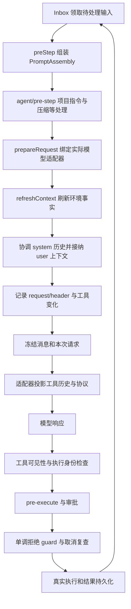
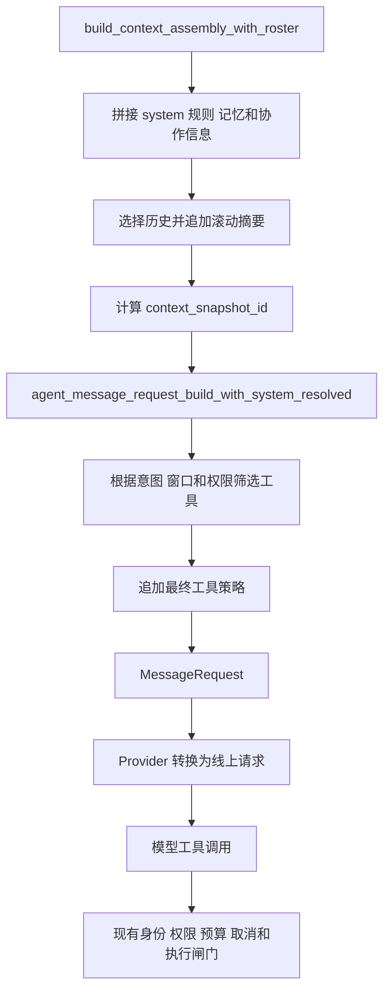

# DeepSeek Harness v0.2.1-rc.2 源码级对齐调研

coolzhuagent 应优先对齐提示词、请求接纳、上下文来源和执行权限之间的契约。完整源码表明，DSH 没有一份可以直接复制后就获得全部能力的系统提示词：部署配置、插件段落、Agent Preset、会话状态、项目指令和模型能力共同决定每次请求。

最先值得处理的是三处：Web 与 CLI 的提示词构造路径不同；记忆和滚动摘要目前进入 system prompt；现有上下文快照早于最终工具筛选和工具策略追加。与此同时，coolzhu 已有真实权限预检、取消与预算控制、调用身份和 Goal 确定性验证，后续对齐应复用这些基础。

## 源码位置与版本依据

| 项目 | 结果 |
|---|---|
| 官方仓库 | [deepseek-ai/deepseek-harness](https://github.com/deepseek-ai/deepseek-harness) |
| 研究版本 | [dsh-v0.2.1-rc.2](https://github.com/deepseek-ai/deepseek-harness/releases/tag/dsh-v0.2.1-rc.2) |
| 固定提交 | `687f282e8625c6b8d11ff58211a90524be2e4317` |
| 桌面源码 | [deepseek-harness-v0.2.1-rc.2](C:/Users/zhupu/Desktop/deepseek-harness-v0.2.1-rc.2) |
| 官方源码包 | [ZIP](C:/Users/zhupu/Desktop/deepseek-harness-v0.2.1-rc.2.zip)，46,562,322 字节 |
| ZIP SHA-256 | `828bbbebaf507d2b1fc335a608e1c8174e2dd5c5c80ebb64d5146ddc5ecb511f` |
| 完整性 | 16,297 个文件，无缺失、无额外文件；16,294 个与 Git blob 逐字节相同，3 个 `.cmd` 按官方 `.gitattributes` 转为 CRLF，规范化后也与 blob 相同 |
| 校验记录 | [source-manifest.json](C:/Users/zhupu/Desktop/deepseek-harness-v0.2.1-rc.2.source-manifest.json) |
| coolzhu 基线 | HEAD `8a13551b037f5f673188802f2c9128984245fab8` 加本次读取时的工作区内容；引用文件的 SHA-256 见[源码证据清单](D:/coolzhuagent/docs/analysis/2026-10-17-deepseek-harness-source-level-evidence.json) |

这是完整提交的源码快照，不含 `.git` 历史或已安装依赖。以下结论分为源码事实和实现建议；测试位置用于提取后续验收案例，本次没有执行上游测试或模型端到端调用。单次版本增量仍以[上一份版本报告](D:/coolzhuagent/docs/analysis/2026-10-17-deepseek-harness-v0.2.1-rc.2-backend-alignment.md)为准，不能把以下所有机制都归为 rc.2 新增。

## DSH 的实际请求调用链

调用点可以按以下顺序阅读，而不是只读 README：

| 阶段 | 入口 | 源码确认的契约 |
|---|---|---|
| 组装 | `SystemPrompt.assemble()`，[index.ts:614][dsh-prompt-assemble] | 合并全局和当前 scope；复制工具参数；排序；执行组装 waterfall；最后重新确立 complete section |
| 进入步骤 | `Agent.preStep()`，[agent.ts:267][dsh-prestep] | 先 claim 输入并组装，再让 pre-step 中间层决定进入、拒绝或调整消息 |
| 选择实际路由 | `Agent.prepareRequest()`，[agent.ts:564][dsh-prepare] | `agent/request` 后调用 `llm.prepareCall()`，得到本次实际配置和能力 |
| 刷新和接纳 | `Agent.step()`，[agent.ts:400][dsh-step] | 规则和工具沿用已组装版本，环境事实重新读取；先协调 system，再持久化本次输入 |
| 固定请求 | `Agent.buildRequest()`，[agent.ts:616][dsh-build] | 记录 header、工具增删事件和请求上下文；冻结 header、嵌套消息和请求外壳，取消信号仍可变化 |
| 协议适配 | [llm/index.ts:1107][dsh-llm-project] | 工具历史再次根据实际 `toolUpdate` 能力转换；会话里的表示不等于各厂商线上协议 |
| 工具派发 | `ToolRuntime.prepareExecution()`，[tools/index.ts:1501][dsh-tool-gate] | 创建执行身份 → pre-execute → 必要审批 → guard → 取消复查 → 派发 |

同一步请求重试不会重新运行整个提示词组装，也不会重复接纳同一批用户输入；实际路由和动态环境仍可重新准备。因此应区分“一个步骤接受的规则快照”和“某一次请求尝试的路由与环境快照”。

## 系统提示词由哪些源码组成

默认 base 配置把 `personaPrefix` 设为空，由 plan-mode 和工具插件分别贡献指导；工具默认采用 native 模式。[base 配置:499][dsh-base-prompt]。这意味着“复制官方 persona 文本”并不是完整的对齐方法。

| 内容 | 组装位置与顺序 | 约束含义 |
|---|---|---|
| Harness 身份与 persona | `HARNESS_IDENTITY=-1000`，`DEPLOYMENT_PERSONA_PREFIX=0` | 确定身份与部署角色；同名 scoped section 可覆盖全局 |
| 计划、团队、PTC 指导 | `PLAN_POLICY=500`，`TEAM_POLICY=600`，`PTC_ONLY=800` | 由相应插件按当前状态提供，不是固定全量文字 |
| 工具指导 | 文件、命令、Web、Goal、子代理等位于 1000–3100 | 与工具实现一起维护；还需和实际可见 schema 一致 |
| 程序化调用与输出 | `TOOLS_SDK=5000`，结构化输出等后置 | PTC SDK 随工具集合生成；模式改变影响可见入口 |
| 动态环境 | 独立 `contexts` 集合，进入带来源的 user-role 消息 | cwd、沙箱、审批等事实不必改写稳定 system 前缀 |
| 项目指令 | `agent-instructions` 通过 pre-step 与 Inbox 注入 | 持久化来源、范围、内容变化和撤销，不是 system-role |

顺序常量见[system-prompt/index.ts:131][dsh-order]。`order` 只是排列顺序，不会给一段文字增加执行权限。

### complete 与 required 的真实边界

`persona` 的 `complete: true` 注册为完整 section。组装 waterfall 之后，注册表会将它恢复为唯一 system section；默认身份、计划指导、工具指导和其他 suffix 都可能不再出现在 system prompt 中。工具声明与 context 仍是独立字段。[persona/index.ts:60][dsh-persona]、[assemble:653][dsh-prompt-complete]

`includeRuntimeContext: false` 只抑制 optional context。`refreshContext()` 会保留已接受的 sections、tools、variables，重读已注册环境提供方，并补回缺少的 required context。[refreshContext:582][dsh-refresh]

**不能把“required context 不可关闭”理解为所有环境说明都不可关闭。** 当前工作目录明确注册 `required: true`、`interpolate: false`；沙箱说明的注册没有 `required: true`。隐藏沙箱说明也不等于关闭真实沙箱。[工作目录:90][dsh-cwd]、[沙箱说明:142][dsh-sandbox-context]

对 coolzhu 的建议：平台执行限制留在宿主权限层；允许用户自定义 persona 时，显式定义哪些指导可替换、哪些状态必须告知，并在请求快照中记录实际结果。模板缺变量、多 complete、重复注册和工具排序错误应在请求前失败。

### 动态 system 和工具更新不能按厂商名猜测

`SystemPromptProjection.project()` 有三个关键分支：[runtime-context.ts:88][dsh-prompt-project]

1. 首次请求创建 system 节点，即使内容为空也占据稳定位置。
2. 实际路由支持 `in-history`、请求序列连续且新内容非空时，在历史后部追加；内容不变则不重复。
3. 不支持、序列重建或提示词清空时，替换首个 system 节点并清空后续有效 system 节点，避免旧规则重新生效。

pi-ai 的 `conversationUpdates()` 检查具体模型目录里的兼容能力，再区分 system 更新、完整工具更新和仅工具追加。不能因为端点兼容 OpenAI API 就假定支持这些语义。[models.ts:75][dsh-model-capability]

## 项目指令的来源与生命周期

`agent-instructions` 识别全局根、共享 agents 根和项目范围，构造 baseline identity，并追踪每个 scope 的版本和有效内容。pre-step 合并待接纳变化；成功的 `read/write/edit` 结果触发相应路径发现，开放步骤中的变化等到 `step/end` 再处理。[index.ts:76][dsh-instruction-touch]、[index.ts:113][dsh-instruction-compose]、[index.ts:330][dsh-instruction-prestep]

渲染层明确说明：更具体的文件指导优先于更广的文件指导，但不能覆盖 system、developer 或人类直接指令；删除会生成“此前内容不再适用”的消息。`<system-reminder>` 是文本包装，不能提升消息角色。[render.ts:16][dsh-instruction-render]

需要对齐的不只是增加 `AGENTS.md` 文件名，还包括：

- 来源标识、项目边界、优先级和预算；base 默认总预算 65,536 字节。
- 同内容去重，更新替换，删除撤销；暂时无法读取不能一律当作删除。
- cwd 切换、离线修改后 resume、压缩移除指令消息后重新注入。
- shell 的 `cd` 或任意外部修改不自动等价于一次成功的结构化文件触达。

coolzhu 的核心库 `discover_instruction_files()` 会沿父目录寻找 `CLAW.md`、`CLAW.local.md`、`.claw/CLAW.md`、`.claw/instructions.md`；builder 将其渲染进 system sections。Web 则使用另一组函数，不能通过仅修改此 builder 就宣称 Web 已获得相同指令生命周期。[prompt.rs:242][cz-instruction-discovery]、[prompt.rs:156][cz-prompt-builder]、[Web 组装:28587][cz-assembly]

## 源码确认的执行约束

| 约束 | 实际执行位置 | 对齐时应保留的边界 |
|---|---|---|
| 计划模式不能改文件 | base 配置提供禁止修改的文字；PlanMode 注册 section 与退出工具 | 工具集合保持稳定，工具仍可调用；真正只读必须由权限／沙箱保证。不要把这套审批流程扩展为所有普通任务都需再次确认 |
| 工具不得越权 | ToolRuntime 的可见性解析、pre-execute、审批和同步 guard | guard 只有拒绝或不干预，没有放行覆盖；规则先显示给模型，实际派发仍复核 |
| 文件不被盲目覆盖 | `FsObservationPolicy.writeIntent/editIntent` 和文件提供方的版本检查 | 未观察的 write 只能尝试 create-if-absent；edit 未读取直接失败。不是“任何 write 都必须先读” |
| Goal 调用者真实 | `goalToolExecution()` 检查活跃实例、当前执行者和开放轮次 | 仅有一条 `role=user` 文本不足以证明人类授权，还要有宿主可信来源与根 Agent 身份 |
| Goal 模型自报 blocked | `tool-goal/index.ts` 对 `goal-round` 检查阈值 | 默认 3，可配置为正整数；直接人类来源可在阈值前阻塞；代码未独立判断“同一个原因连续出现” |
| 已暂停 Goal 的恢复 | `update_goal` 额外拒绝恢复 durable paused 状态 | 即使在新的人类轮次也不能由这条模型工具恢复 paused；需走产品提供的用户恢复入口 |
| PTC 保留变量 | Node persistent runtime 与 policy-processes | 权限变更使环境失效；取消或超时清理后再接纳；一次提权使用独立环境 |

对应实现：[计划文字:332][dsh-plan-policy]、[计划注册:216][dsh-plan-register]、[工具 gate:1501][dsh-tool-gate]、[文件策略:65][dsh-file-policy]、[Goal 身份:49][dsh-goal-authority]、[Goal 更新:270][dsh-goal-update]、[Goal 阈值:305][dsh-goal-block]、[PTC 清理:21][dsh-ptc-policy]。

有一个值得单独移植的来源规则：DSH 的 `Agent.followup()/steer()` 未提供 source 时会默认视作 user，因此其 Goal 身份检查明确要求非人类生产者主动提供来源。coolzhu 应在宿主入口强制区分真实用户、自动推进、工具结果、子任务消息、文件指令和摘要；不能让插件仅靠填写字符串取得人类授权。[authority.ts:83][dsh-human-source]

DSH 默认 Goal 指导允许从人类的长期目标请求推断创建意图；是否在 coolzhu 采用这种行为属于产品决策。可直接对齐的是身份、revision 和生命周期检查；完成验收仍应保留 coolzhu 的文件／命令验证门及预算。

## coolzhu 的实际请求路径与差异

### 记忆和摘要与稳定规则混合

`build_agent_system_prompt_with_beads()` 把 memory beads 放在 system 字符串中；`build_context_assembly_with_roster()` 将滚动历史摘要继续追加到该字符串。现有过滤器会排除部分过时工具判断和临时 Goal 记忆，但其传输角色仍是 system。[main.rs:28300][cz-system-memory]、[main.rs:28770][cz-summary]

这是已确认的输入结构差异，不能仅凭静态代码断言发生了越权。建议将平台规则与记忆、历史摘要、运行环境拆为带来源的内容块；模型生成的摘要不应自动获得平台规则的身份。保留现有记忆选择、预算和过时能力过滤，并增加“记忆声称有权限、实际执行仍拒绝”的验收。

### 现有上下文快照不是最终请求快照

`context_snapshot_id` 在 assembly 内计算，使用当时的 system 和目录 revision；随后请求构造会执行 `select_tools_for_request()`、移除不适用的桌面工具、追加 `request_tool_policy_instruction()`。模型适配器还会进一步转换协议。[main.rs:28841][cz-context-snapshot]、[main.rs:33532][cz-final-request]、[openai_compat.rs:1050][cz-wire]

因此不能仅凭当前 snapshot ID 声称已准确还原最终的 system、schema 和 provider payload。现有 `RequestAttemptSnapshot` 记录派发、模型、协议、状态和 usage，可扩展关联最终请求指纹；它目前没有承载规则、工具或消息内容摘要的指纹字段。[request_observer.rs:41][cz-request-observer]

建议保留 `context_snapshot_id` 的组装含义，新增最终接纳记录，关联规则版本、实际工具 schema hash、provider/model 能力、cwd/权限版本、消息投影版本和 request attempt。无需将密钥或完整敏感正文写入诊断记录。

### Web 和 CLI 需要共用契约

Web 使用 `build_agent_system_prompt*` 与 `build_context_assembly*`；CLI 的 `build_system_prompt()` 调用核心库 `load_system_prompt()`，`ConversationRuntime` 的每次迭代复制自己的 system 向量。[CLI:2927][cz-cli-prompt]、[conversation.rs:265][cz-core-loop]

建议先让两条路径共用结构化输出和来源定义，再逐步收拢渲染逻辑。仅把 Web 的大字符串迁移到另一文件，无法解决覆盖、撤销、恢复和模型适配问题。

### 工具权限与 DSH 插件宿主已有明确基础

`tool_dispatch_service` 在 hook 前执行真实宿主权限预检，并绑定父身份、请求调用身份、最早预算和取消状态；pre-hook 后继续进入实际派发检查；post-hook 失败不会撤销已产生效果，也不能触发盲目重试。[dispatch_service.rs:27][cz-dispatch]

DSH 宿主只接受 `tools` 服务依赖，启动 `SystemPrompt` 与 native `ToolRuntime`，导出工具清单并执行。它显式不把插件 `concludeTurn`、`additionalContexts` 当作控制指令交回 Rust。因此升级 npm 包不会自动带来 DSH 的 PromptAssembly、Session 日志、子代理或 Goal 驱动能力。[host.mjs:143][cz-dsh-host]

当前包仍锁定 `0.1.1-rc.2`，包括新版本已删除的 `dsh-invariants`。升级应独立验证服务注入、schema、取消、卸载和返回结构，不能把完整 DSH base 直接装进只提供 tools 的兼容层。

## 子任务与会话恢复的对齐边界

DSH 委派工具在接纳后返回 `{ kind: 'activation', subagentId }`，此时不代表任务完成；真正完成由托管 activation 和通知处理。`session/wait` 的实现是循环等待根 Agent idle、等待后代，再检查根的状态和事件序号是否仍稳定。[tool-subagent:337][dsh-spawn]、[server.ts:240][dsh-wait]

`waitForChildren()` 还处理正在创建的子任务、外部 activation 和收尾过程。驻留子会话不应只按“对象是否还存在”判断忙碌。[manager.ts:252][dsh-children]

`resume()` 保留原 ID 和存储目录，对不存在、读取失败、已经占用的会话报错；不会静默创建替代会话。[server.ts:222][dsh-resume]

coolzhu 的 `HostModelSnapshot` 已冻结模型、工具、权限和工作区，子工具集合只能收窄，且当前宿主明确是同步子执行。对齐异步任务时应保留这些限制，并增加持久 activation、状态查询、完成通知和整体 wait，不能只让函数提前返回一个 ID。[host_child_agent.rs:55][cz-child]

## 建议的实现批次

以下沿用上一份报告 H01–H10 编号。H10 的“最终请求关联”因本轮确认的快照时序差异提升到 P0；可视化调试界面仍可后做。

| 任务 | 优先级 | 建议落点 | 可交付结果 |
|---|---|---|---|
| H01 统一输入契约 | P0 | core-runtime 的 prompt 模块；Web 两组 builder；CLI load_system_prompt 接口 | sections、contexts、tools、来源与 scope 有统一结构；模板错误请求前失败 |
| H02 模型更新能力 | P0 | llm-adapter 的请求类型、能力解析和 provider 投影 | 实际请求绑定 system/tool 更新能力；未知能力保守处理；恢复与清空不激活旧规则 |
| H03 指令生命周期 | P0 | 核心指令发现；Web pre-step 对应位置；会话持久层 | 兼容 CLAW 并支持 AGENTS/CLAUDE；新增、替换、撤销、压缩和恢复一致 |
| H04 执行约束与来源 | P0 | tool_dispatch_service、现有冻结上下文、Goal 工具入口 | 非人类来源不升级授权；hook 不覆盖拒绝；取消和重复调用不产生新动作 |
| H10 最终请求关联 | P0／P2 | ContextRuntimeSnapshot、RequestAttemptSnapshot、provider 派发边界 | P0 记录可核对的最终指纹；P2 再做查看界面 |
| H05 异步子任务 | P1 | host_child_agent 与现有任务、执行记录 | activation 与完成分离；等待覆盖后代；晚到结果和失败有真实终态 |
| H06 会话 cwd | P1 | 会话状态、文件工具、进程入口和指令发现 | 两会话目录互不影响；变更不扩大授权；无效目录恢复行为明确 |
| H07 插件兼容层升级 | P1 | dsh-plugin-host/package.json 与 host.mjs；dsh_execution.rs | 单独完成 0.1.1 → 0.2.1 兼容验证，不隐式接管 Rust 会话权限 |
| H08 Search／Fetch | P1 | tool-registry 的 Web provider | 保留现有工具契约，新增官方 API 路由、凭据与失败语义 |
| H09 PTC 与工作树 | P2 | 有明确需求后单独设计运行进程与文件边界 | 常驻变量、一次授权、目录及清理有统一生命周期 |

H01 的建议最小数据模型是 `PromptSection`、`RuntimeContextEntry`、`InstructionSource`、`PreparedModelCapabilities` 和 `AdmittedRequestSnapshot`。每个内容块至少能表达来源、作用域、内容版本、消息角色及更新策略；只有动态上下文需要 required 标记。权限裁决继续由现有执行层拥有，不在 prompt registry 维护另一份可放行的权限状态。

第一批只实现 H01、H02、H03 的共同契约、H04 回归和 H10 的最终请求关联即可形成可验证闭环。存储可继续使用 SQLite，不需要先迁移为 Cordis 或 JSONL。

## 从现有测试提取的验收清单

以下是源码中的测试位置与要移植的行为，不是本次测试通过记录。

| 场景 | 上游测试依据 | coolzhu 验收要求 |
|---|---|---|
| 规则不串会话 | [scoped.spec.ts:33][test-scoped] | A 的 persona 覆盖不影响 B；卸载后恢复 |
| 必需上下文与刷新 | [system-prompt.spec.ts:36][test-context] | 关闭 optional 不丢 cwd；刷新不改变已接纳 schema 和规则 |
| complete 和模板校验 | [system-prompt.spec.ts:497][test-complete] | 多 complete、未解析变量失败；结果与配置一致 |
| 清空与旧规则 | [system-prompt-projection.spec.ts:203][test-clear] | 多个历史 system 节点全部失效，重试／恢复不复活 |
| 路由能力变化 | [system-prompt-admission.spec.ts:107][test-route] | 以 prepared route 为准；schema 同名改定义后正确重建 |
| 冻结与取消 | [request-freeze.spec.ts:46][test-freeze] | 事件／配置后续变化不污染在途请求；取消信号仍生效 |
| 指令恢复、撤销 | [agent-instructions.spec.ts:2693][test-instruction-resume]、[删除:2825][test-instruction-remove] | 离线修改、删除有显式更新；暂不可读不误撤销 |
| 指令压缩恢复 | [agent-instructions.spec.ts:4764][test-instruction-compact] | 有效规则被压缩后重新接纳，撤销过的规则不回来 |
| guard 顺序 | [tools/scoped.spec.ts:284][test-guard] | 任意 pre-hook 放行不消除宿主拒绝 |
| 文件并发版本 | [policy.spec.ts:116][test-file-policy] | 新建不覆盖现有文件；编辑需观察；旧版本写入失败 |
| cwd 隔离与恢复 | [working-directory.spec.ts:40][test-cwd] | A 切目录不影响 B；重启恢复；目录删除有明确结果 |
| 子任务完成 | [sdk/server/tests/wait.spec.ts][test-wait] | 父 idle 但子仍运行时 wait 不提前结束；失败与完成分开 |
| Goal 来源与暂停 | [tool-goal.spec.ts:243][test-goal-authority]、[暂停:387][test-goal-paused] | 非人类／子 Agent 不取得根权限；暂停不能被晚到回复恢复 |
| Goal 阈值 | [tool-goal.spec.ts:602][test-goal-block] | 区分自动轮次和直接人类来源，不把默认 3 写成不可配置常量 |
| PTC 清理 | [persistent.spec.ts:180][test-ptc]、[ptc-calls.spec.ts:21][test-ptc-policy] | 取消后等待清理；权限变更后不复用旧环境 |

coolzhu 可复用的现有测试包括：`context_builder_enforces_prompt_budget_with_image_and_history`、`context_snapshot_id_changes_when_runtime_scope_changes`、`agent_message_request_with_context_uses_assembled_messages_and_system`、`tool_policy_session_overrides_do_not_inherit_dev_open_exposure`；以及 [hook 预算测试][cz-hook-tests]和 `goal_phase_token_finalizer_repair_returns_to_verifier_without_resetting_budget`。新增测试应检查跨层行为，不只是断言提示词含有某一句文字。

[dsh-prompt-assemble]: C:/Users/zhupu/Desktop/deepseek-harness-v0.2.1-rc.2/packages/core/system-prompt/src/index.ts:614
[dsh-prompt-complete]: C:/Users/zhupu/Desktop/deepseek-harness-v0.2.1-rc.2/packages/core/system-prompt/src/index.ts:653
[dsh-refresh]: C:/Users/zhupu/Desktop/deepseek-harness-v0.2.1-rc.2/packages/core/system-prompt/src/index.ts:582
[dsh-order]: C:/Users/zhupu/Desktop/deepseek-harness-v0.2.1-rc.2/packages/core/system-prompt/src/index.ts:131
[dsh-prestep]: C:/Users/zhupu/Desktop/deepseek-harness-v0.2.1-rc.2/packages/core/agent-loop/src/agent.ts:267
[dsh-step]: C:/Users/zhupu/Desktop/deepseek-harness-v0.2.1-rc.2/packages/core/agent-loop/src/agent.ts:400
[dsh-prepare]: C:/Users/zhupu/Desktop/deepseek-harness-v0.2.1-rc.2/packages/core/agent-loop/src/agent.ts:564
[dsh-build]: C:/Users/zhupu/Desktop/deepseek-harness-v0.2.1-rc.2/packages/core/agent-loop/src/agent.ts:616
[dsh-prompt-project]: C:/Users/zhupu/Desktop/deepseek-harness-v0.2.1-rc.2/packages/core/agent-loop/src/runtime-context.ts:88
[dsh-llm-project]: C:/Users/zhupu/Desktop/deepseek-harness-v0.2.1-rc.2/packages/llm/llm/src/index.ts:1107
[dsh-model-capability]: C:/Users/zhupu/Desktop/deepseek-harness-v0.2.1-rc.2/packages/llm/llm-pi-ai/src/models.ts:75
[dsh-tool-gate]: C:/Users/zhupu/Desktop/deepseek-harness-v0.2.1-rc.2/packages/core/tools/src/index.ts:1501
[dsh-persona]: C:/Users/zhupu/Desktop/deepseek-harness-v0.2.1-rc.2/packages/preset/persona/src/index.ts:60
[dsh-cwd]: C:/Users/zhupu/Desktop/deepseek-harness-v0.2.1-rc.2/packages/session/working-directory/src/index.ts:90
[dsh-sandbox-context]: C:/Users/zhupu/Desktop/deepseek-harness-v0.2.1-rc.2/packages/sandbox/sandbox-policy/src/index.ts:142
[dsh-base-prompt]: C:/Users/zhupu/Desktop/deepseek-harness-v0.2.1-rc.2/packages/bundle/base/cordis.patch.yml:499
[dsh-plan-policy]: C:/Users/zhupu/Desktop/deepseek-harness-v0.2.1-rc.2/packages/bundle/base/cordis.patch.yml:332
[dsh-plan-register]: C:/Users/zhupu/Desktop/deepseek-harness-v0.2.1-rc.2/packages/plan/plan-mode/src/index.ts:216
[dsh-instruction-touch]: C:/Users/zhupu/Desktop/deepseek-harness-v0.2.1-rc.2/packages/context/agent-instructions/src/index.ts:76
[dsh-instruction-compose]: C:/Users/zhupu/Desktop/deepseek-harness-v0.2.1-rc.2/packages/context/agent-instructions/src/index.ts:113
[dsh-instruction-prestep]: C:/Users/zhupu/Desktop/deepseek-harness-v0.2.1-rc.2/packages/context/agent-instructions/src/index.ts:330
[dsh-instruction-render]: C:/Users/zhupu/Desktop/deepseek-harness-v0.2.1-rc.2/packages/context/agent-instructions/src/render.ts:16
[dsh-file-policy]: C:/Users/zhupu/Desktop/deepseek-harness-v0.2.1-rc.2/packages/fs/fs-observation-policy/src/index.ts:65
[dsh-goal-authority]: C:/Users/zhupu/Desktop/deepseek-harness-v0.2.1-rc.2/packages/goal/tool-goal/src/authority.ts:49
[dsh-human-source]: C:/Users/zhupu/Desktop/deepseek-harness-v0.2.1-rc.2/packages/goal/tool-goal/src/authority.ts:83
[dsh-goal-update]: C:/Users/zhupu/Desktop/deepseek-harness-v0.2.1-rc.2/packages/goal/tool-goal/src/index.ts:270
[dsh-goal-block]: C:/Users/zhupu/Desktop/deepseek-harness-v0.2.1-rc.2/packages/goal/tool-goal/src/index.ts:305
[dsh-ptc-policy]: C:/Users/zhupu/Desktop/deepseek-harness-v0.2.1-rc.2/packages/ptc-runtime/ptc-runtime-node/src/policy-processes.ts:21
[dsh-spawn]: C:/Users/zhupu/Desktop/deepseek-harness-v0.2.1-rc.2/packages/subagent/tool-subagent/src/index.ts:337
[dsh-wait]: C:/Users/zhupu/Desktop/deepseek-harness-v0.2.1-rc.2/packages/sdk/server/src/server.ts:240
[dsh-resume]: C:/Users/zhupu/Desktop/deepseek-harness-v0.2.1-rc.2/packages/sdk/server/src/server.ts:222
[dsh-children]: C:/Users/zhupu/Desktop/deepseek-harness-v0.2.1-rc.2/packages/subagent/subagent/src/manager.ts:252
[cz-prompt-builder]: D:/coolzhuagent/modules/core-runtime/packages/core-runtime/src/prompt.rs:156
[cz-instruction-discovery]: D:/coolzhuagent/modules/core-runtime/packages/core-runtime/src/prompt.rs:242
[cz-system-memory]: D:/coolzhuagent/modules/gui-web/packages/web-console/src/main.rs:28300
[cz-assembly]: D:/coolzhuagent/modules/gui-web/packages/web-console/src/main.rs:28587
[cz-summary]: D:/coolzhuagent/modules/gui-web/packages/web-console/src/main.rs:28770
[cz-context-snapshot]: D:/coolzhuagent/modules/gui-web/packages/web-console/src/main.rs:28841
[cz-final-request]: D:/coolzhuagent/modules/gui-web/packages/web-console/src/main.rs:33532
[cz-wire]: D:/coolzhuagent/modules/llm-adapter/packages/llm-adapter/src/providers/openai_compat.rs:1050
[cz-request-observer]: D:/coolzhuagent/modules/llm-adapter/packages/llm-adapter/src/request_observer.rs:41
[cz-cli-prompt]: D:/coolzhuagent/modules/cli/packages/command-line/src/main.rs:2927
[cz-core-loop]: D:/coolzhuagent/modules/core-runtime/packages/core-runtime/src/conversation.rs:265
[cz-dispatch]: D:/coolzhuagent/modules/gui-web/packages/web-console/src/tool_dispatch_service.rs:27
[cz-dsh-host]: D:/coolzhuagent/modules/tooling/packages/dsh-plugin-host/src/host.mjs:143
[cz-child]: D:/coolzhuagent/modules/gui-web/packages/web-console/src/host_child_agent.rs:55
[cz-hook-tests]: D:/coolzhuagent/modules/gui-web/packages/web-console/src/dispatch_hook_budget_tests.rs:97
[test-scoped]: C:/Users/zhupu/Desktop/deepseek-harness-v0.2.1-rc.2/packages/core/system-prompt/tests/scoped.spec.ts:33
[test-context]: C:/Users/zhupu/Desktop/deepseek-harness-v0.2.1-rc.2/packages/core/system-prompt/tests/system-prompt.spec.ts:36
[test-complete]: C:/Users/zhupu/Desktop/deepseek-harness-v0.2.1-rc.2/packages/core/system-prompt/tests/system-prompt.spec.ts:497
[test-clear]: C:/Users/zhupu/Desktop/deepseek-harness-v0.2.1-rc.2/packages/core/agent-loop/tests/system-prompt-projection.spec.ts:203
[test-route]: C:/Users/zhupu/Desktop/deepseek-harness-v0.2.1-rc.2/packages/core/agent-loop/tests/system-prompt-admission.spec.ts:107
[test-freeze]: C:/Users/zhupu/Desktop/deepseek-harness-v0.2.1-rc.2/packages/core/agent-loop/tests/request-freeze.spec.ts:46
[test-instruction-resume]: C:/Users/zhupu/Desktop/deepseek-harness-v0.2.1-rc.2/packages/context/agent-instructions/tests/agent-instructions.spec.ts:2693
[test-instruction-remove]: C:/Users/zhupu/Desktop/deepseek-harness-v0.2.1-rc.2/packages/context/agent-instructions/tests/agent-instructions.spec.ts:2825
[test-instruction-compact]: C:/Users/zhupu/Desktop/deepseek-harness-v0.2.1-rc.2/packages/context/agent-instructions/tests/agent-instructions.spec.ts:4764
[test-guard]: C:/Users/zhupu/Desktop/deepseek-harness-v0.2.1-rc.2/packages/core/tools/tests/scoped.spec.ts:284
[test-file-policy]: C:/Users/zhupu/Desktop/deepseek-harness-v0.2.1-rc.2/packages/fs/fs-observation-policy/tests/policy.spec.ts:116
[test-cwd]: C:/Users/zhupu/Desktop/deepseek-harness-v0.2.1-rc.2/packages/session/working-directory/tests/working-directory.spec.ts:40
[test-wait]: C:/Users/zhupu/Desktop/deepseek-harness-v0.2.1-rc.2/packages/sdk/server/tests/wait.spec.ts
[test-goal-authority]: C:/Users/zhupu/Desktop/deepseek-harness-v0.2.1-rc.2/packages/goal/tool-goal/tests/tool-goal.spec.ts:243
[test-goal-paused]: C:/Users/zhupu/Desktop/deepseek-harness-v0.2.1-rc.2/packages/goal/tool-goal/tests/tool-goal.spec.ts:387
[test-goal-block]: C:/Users/zhupu/Desktop/deepseek-harness-v0.2.1-rc.2/packages/goal/tool-goal/tests/tool-goal.spec.ts:602
[test-ptc]: C:/Users/zhupu/Desktop/deepseek-harness-v0.2.1-rc.2/packages/ptc-runtime/ptc-runtime-node/tests/persistent.spec.ts:180
[test-ptc-policy]: C:/Users/zhupu/Desktop/deepseek-harness-v0.2.1-rc.2/packages/core/tools/tests/ptc-calls.spec.ts:21
