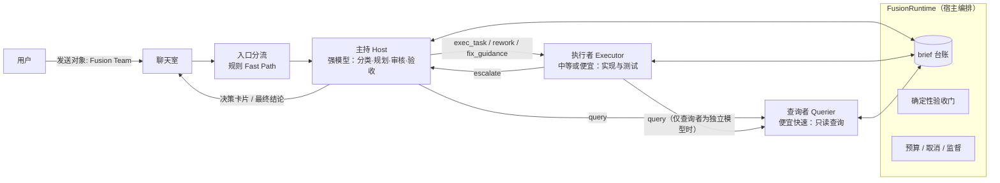
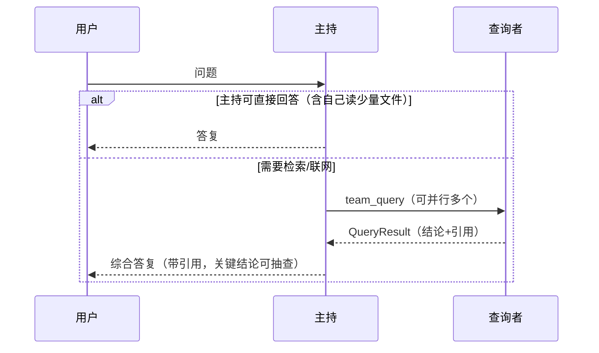
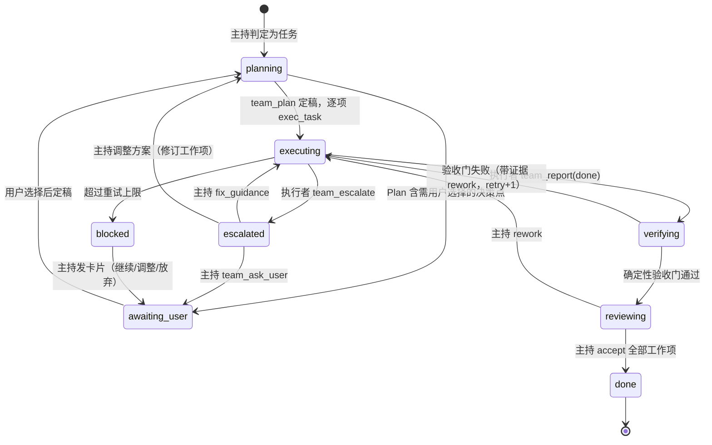

# Fusion Team（模型聚合会话）· 方案设计

- 文档编号：`DESIGN-FUSION-001`
- 日期：2026-11-09
- 状态：草案 v3（三角色精简版，评审结论已纳入；本轮只出设计，不含实现）
- 取代：Goal 模式角色分配（`goal_role_configs` / 主控 commander / planner·implementer·verifier 阶段链），见 §13 移除计划
- 修订记录：v1 为五角色（主持/查询者/方案专家/审核专家/执行者）；v2 按评审意见把方案与审核职责并入主持，精简为三角色；v3 落实评审结论——Team 需启用且配置完整才出现在发送对象、问答不落任务记录、主持联网改为可选开关

## 0. 已确认的产品决策（2026-11-09）

| 决策点 | 结论 | 对设计的约束 |
|---|---|---|
| 角色构成 | **三角色：主持（强模型）、执行者（中等或便宜模型）、查询者（便宜且快速的模型）**；方案设计与审核由主持承担 | 主持需要只读文件工具做规划与验收（§5.1） |
| 执行者与查询者 | **可分开配置，也可以是同一个模型** | 同模型时仍是两条独立角色线程（§5.4） |
| 与 Goal 的关系 | **彻底移除 Goal** | Fusion 自带验收门、重试上限、预算、人工决策；Goal 历史数据只读保留，不做破坏性删除（§13） |
| 聊天室可见性 | **所有角色直接发言** | 每个角色的派发、结果、决策都以独立消息出现在聊天室；需要紧凑渲染与降噪（§8） |
| 角色上下文 | **角色独立上下文 + brief 交换** | 角色模型请求**不读聊天室全量历史**；聊天室是展示面，角色线程是模型上下文（§7） |
| 发送对象显示 | **不需要工作区默认 Team**；设置中启用 Team 且必填角色（主持、执行者）配置完整后，才出现在会话发送对象列表 | 前端下拉按"已启用且有效"过滤；停用或配置残缺时隐藏并回退（§12.2） |
| 问答留痕 | **问答型会话不存任务记录** | 不落 `fusion_tasks`；其查询 brief 仍入台账（`task_id` 可空）便于取消与恢复（§6.2、§9） |
| 主持联网 | **默认不联网**；Team 设置提供"主持联网检索"开关 | 关闭时主持无 Web 工具，联网一律派查询者（§5.1、§12.1） |
| 交付范围 | **只出设计文档** | 实现另起 PR |

"所有角色发言"与"上下文独立"不冲突：**展示**（聊天室里人人可见）和**模型上下文**（每个角色只看自己的线程）是两层数据，本设计严格分开。

---

## 1. 背景与目标

### 1.1 现状问题

现有 Goal 角色分配把"角色"绑定到"会话"（一个会话 = 一份模型配置），并以阶段链推进：

- 角色与会话一一独占：`assign_goal_roles_sqlite` 会把同一角色从其它会话上移除（`main.rs:50386`）。
- 角色模板是固定枚举：`normalize_goal_role`（`main.rs:51058`）。
- 推进是 phase 状态图：`PhaseStage`（`goal_phase_stage.rs`）只有 Execution / Replanning / Repair 三种回退路由。
- 用户不能把"一组模型"当作一个**发送对象**：聊天发送只认单个会话或群发接力（`prepare_chat_dispatch_checked`，`main.rs:21760-21815`；`relay_dispatch`，`main.rs:19646`）。
- 没有"问答型 vs 任务型"的入口分流；任何 Goal 都走完整阶段链。

### 1.2 目标

- **G1**：可配置一个 **Fusion Team**（默认命名"Fusion Team"），为主持、执行者、查询者各选模型会话；执行者与查询者可同模型；Team 作为聊天室的**单一发送对象**。
- **G2**：主持识别问答型 / 任务型 / 追问 / 取消 / 决策回复；问答走轻路径，任务走协作路径。
- **G3**：角色之间只交换结构化 **brief / 结果 / 反馈**，每个角色维护独立、可缓存的持久上下文。
- **G4**：需要用户拍板的事项**只经主持**以"决策卡片"呈现，任务挂起直至用户回复（跨重启持久）。
- **G5**：任务型会话具备确定性验收（文件存在 / 命令通过）、重试上限、预算、取消、重启后不重放副作用。
- **G6**：平滑移除 Goal，不丢历史数据。

### 1.3 非目标

- 首期不提供方案专家、审核专家等独立角色（§14 P3 预留扩展位）。
- 不做跨聊天室共享团队上下文（角色线程按房间隔离）。
- 首期不支持 Devin ACP / OpenAI 订阅 / Devin Cloud 会话担任角色（§10.8）。
- 不做事件驱动的主动执行。

---

## 2. 外部参考与取舍

### 2.1 Devin Fusion（Cognition）

来源：[Devin Fusion](https://cognition.com/blog/devin-fusion)、[Fusion in Devin Desktop & CLI](https://cognition.com/blog/local-fusion)、[CLI 文档](https://docs.devin.ai/cli/fusion)。

精简版的主持 + 执行者就是 Fusion 的 **lead + sidekick**；查询者是在其基础上增加的低成本只读通道。

| 机制 | 原文要点 | 本设计采纳方式 |
|---|---|---|
| 两个并行 agent，各有持久上下文 | 用户只与 lead 交互 | 主持 = lead；执行者 = sidekick；各自独立角色线程 |
| 只交换 brief / 结果 / 反馈 | 不传整段对话 | §7 brief 协议 |
| lead 负责计划、歧义解释、最终评审 | lead 应**少动手、只读必要内容**，默认委派并监控 | 主持做规划与审核，只读不写、无 shell |
| lead 可收回控制权 | sidekick 力不从心时 lead 接管 | 执行者升级后由主持给修复指导、调整方案或交用户决定（§6.3） |
| 规划所需探索不宜交给弱 sidekick | 探索结果会塑造计划 | 查询者便宜快速时，`delegate_planning_exploration` 默认关闭，主持自行读关键代码（§7.5） |
| 更强的 sidekick 可能整体更省 | 少返工、少评审轮次 | 配置提示：执行者不宜过弱（§12.1） |
| 按组合调参 | brief 详细程度、是否允许 sidekick 反驳、探索是否委派 | §7.5 三个开关 |
| 压缩时切换模型 | 压缩本就破坏缓存 | P3 |
| 按每任务成本评估 | 不是每 token 价格 | §15.3 |

### 2.2 DeepSeek Super-agent（"superharness"）

来源：[Exploring Super-agent Design](https://nitter.gq/DeepSeekHarness/article/2116857257245987236)、[dsh-superagent-prototype](https://github.com/deepseek-ai/dsh-superagent-prototype/)；DSH 本体分析见 `docs/analysis/2026-10-17-deepseek-harness-source-level-alignment.md`。

| 机制 | 原文要点 | 本设计采纳方式 |
|---|---|---|
| Router / Worker 两层 | Router 负责人机交互与派发、可无 Bash；Worker 上下文隔离、工具齐全 | 主持无 shell、无写；执行者是唯一写入角色 |
| Router 不深度拆解任务 | 为多任务并发吞吐而设计 | **不采纳**：本场景是单会话内的连贯任务，主持按 Fusion lead 方式规划与评审 |
| Ticket + 不可变 Mandate | 记录"为什么可以执行" | `fusion_tasks.mandate_json`，brief 不能扩大授权（§9） |
| Fast Path / Slow Path | 确定性规则先过滤 | 入口分流先走规则，再交主持判断（§6.1） |
| Inline & Spill / Chain of Recall | 只内联摘要与 ID，按需召回 | `team_recall(id)`（§7.4） |
| 全双工异步 | start/stop，完成后事件回送 | `team_dispatch` 立即返回，结果作为事件唤醒派发方（§10.3） |

### 2.3 精简版的取舍

- **优点**：交接链最短（主持 ⇄ 执行者，外加只读查询），与 Fusion 实测有效的结构一致；配置门槛低（最少两个模型即可）。
- **代价**：主持同时承担规划、审核、验收，强模型 token 占比上升。对冲：主持只读必要文件；实现期的代码探索由执行者自己完成；网络与大范围检索交给查询者；用 §15.3 的每角色成本数据决定是否在 P3 拆出独立角色。

---

## 3. 现状勘察：可复用与需替换

| 能力 | 现有实现 | Fusion 处理 |
|---|---|---|
| 模型会话 | `PersistedSession`（`main.rs:53609`）、`AgentSessionDto`（`main.rs:53321`） | **复用**：角色绑定会话 ID，不复制凭据 |
| 发送对象解析 | `prepare_chat_dispatch_checked`（`main.rs:21785-21815`），Devin 已有"仅单目标"先例（`main.rs:21817-21825`） | **扩展**：识别 `fusion:<team_id>` 伪目标，必须单目标 |
| 模型工具循环 | `agent_chat_response`（`main.rs:28338`）、`call_agent_model_with_tool_loop`（`main.rs:29111`） | **复用**：上下文改为角色线程 |
| 子执行冻结快照 | `HostModelSnapshot`（`host_child_agent.rs:55`）；`child_tools` 排除 `Agent`，不可递归（`host_child_agent.rs:156-166`） | **借鉴**：Fusion 派发由宿主编排，不让模型递归调用 Agent 工具 |
| 执行索引 / 取消 / 用量 | `execution_service.rs`：`Source`、`ExecutionSpec`、`TurnRunner`、`require_capability`（L14-47） | **扩展**：新增 `Source::FusionRole` |
| 工具监督 | `runtime_tool_supervision.rs`（unsettled 门、Sleep 可中断、TaskOutput 有界等待） | **复用**：监督 key 增加角色维度 |
| 权限 | `required_permission_for_tool`（`main.rs:3744`）、`llm_tool_permission_for_room`（`main.rs:35161`）、`llm_tool_definitions_for_session`（`main.rs:35348`）；完全访问仅本进程有效（`main.rs:44054`） | **复用**：角色上限 ∩ 房间权限 |
| 房间任务清单 | `chat_todos.rs`（`chat_room_todos`） | **复用**：主持的计划同步到现有清单 UI |
| 可见转录分页 | `VISIBLE_SQL`（`chat_insights.rs:61`）与 `shouldRenderCompletedMessage`（`app.js:15427`）必须同义 | **扩展**：新增 fusion 消息 kind，两处同步并加一致性测试 |
| 房间内交接 | `chat_handoff`（`main.rs:35282`） | **不用于 Fusion**，保留给普通房间 |
| 验收门 / 重试 / 人工确认 | `goal_verification.rs`、`goal_command.rs`、`goal_phases.retry_count/max_retries/human_ack` | **移植后删除**（§13 R0） |
| Goal 本体 | 表 `goals/goal_phases/goal_events`（`main.rs:44312-44358`）、`goal_role_configs`（`main.rs:44371`）、路由 `main.rs:1929-2002`、`run_goal_phase_once`（`main.rs:19003`） | **移除**（§13） |

Goal 耦合面：`modules/**/*.rs` 中 goal 相关符号约 1390 处、16 个源文件；前端 js/html/css 约 1100 处。移除必须分阶段。

---

## 4. 总体架构



核心原则：

1. **编排归宿主**：角色通过 team 工具表达意图（规划、派发、汇报、升级、请求决策）；`FusionRuntime` 校验派发矩阵、落台账、调度运行、执行预算与验收。
2. **每个角色 = 一个 RoleAgent**：绑定的模型会话 + 独立角色线程 + 工具清单 + 权限上限。
3. **展示与上下文分离**：发言写入聊天室；模型请求只读该角色自己的线程。
4. **硬约束确定性执行**：权限、矩阵、预算、验收命令由宿主判定，不依赖提示词自律。

---

## 5. 角色定义

### 5.1 职责与权限

| 角色 | 推荐模型 | 职责 | 权限上限 | 主要工具 | 产出契约 |
|---|---|---|---|---|---|
| **主持** Host | 前沿强模型，较高推理强度 | 用户唯一决策接口；识别会话类型；问答直接作答或派查询；**任务拆解与方案设计**（含可选方案）；按计划派执行；**处理执行者升级**（修复指导 / 调整方案 / 交用户）；**审核执行结果与最终验收**；需要用户选择时发决策卡片 | ReadOnly：**可读文件，无 shell、无写** | Read/Grep/Glob/LSP、WebSearch/WebFetch（开关默认关）、`team_plan`、`team_dispatch`、`team_query`、`team_wait`、`team_recall`、`team_ask_user`、`team_accept`、`TodoWrite` | 用户可读回复；`Plan`；审核与验收结论 |
| **执行者** Executor | 中等或便宜但编码可靠的模型 | 代码实现与测试；遇阻向主持升级 | WorkspaceWrite；房间已授完全访问时可升至 DangerFullAccess | 文件读写编辑、Shell/PowerShell、TaskOutput/TaskStop、WebSearch/WebFetch（随会话开放）、`team_query`（仅查询者为独立模型时）、`team_escalate`、`team_report` | `ExecutionReport`：改动文件、命令与退出码、测试结果、遗留问题 |
| **查询者** Querier | 便宜且快速的模型，低推理强度 | 代码、文件、网络信息查询；只回答被问的问题 | ReadOnly | Read/Grep/Glob/LSP、WebSearch/WebFetch、`team_report` | `QueryResult`：结论 + 引用（文件:行 / URL）+ 置信度 |

实际权限 = `min(角色上限, 房间权限)`；房间"完全访问"仍为进程级（`main.rs:44054`），Fusion 不改变该安全语义。

### 5.2 派发矩阵（宿主强制）

| 发起方 \ 目标 | 主持 | 执行者 | 查询者 | 用户 |
|---|---|---|---|---|
| 主持 | — | `exec_task` / `rework` / `fix_guidance` | `query` | **决策卡片、阶段汇报、最终结论** |
| 执行者 | `escalate`；对收到的 brief 回送结果 | — | `query`（仅查询者为独立模型时） | ✗ |
| 查询者 | 回送结果 | 回送结果 | — | ✗ |

- "回送结果"是对收到的 brief 调用 `team_report`，不是新派发。
- 查询者是**叶子**，不能派发任何角色。
- 违反矩阵的工具调用由宿主拒绝并返回可读原因。

### 5.3 "所有角色发言"与"只有主持问用户"

所有角色的发言都进入聊天室，但 `team_ask_user` 只对主持可见。执行者认为需要用户决定时，通过 `team_escalate` 交主持，由主持合并后统一发问，避免多个角色同时向用户提问。

### 5.4 执行者与查询者同模型

配置项 `querier.session = same_as_executor | <session_id>`，未配置查询者时默认 `same_as_executor`。

| 情形 | 行为 |
|---|---|
| 同模型 | 仍是**两条独立角色线程**：主持派给查询者的检索不进入执行者上下文，执行者的实现上下文保持干净；两条线程可并行运行。**执行者不暴露 `team_query`**——同一模型多一跳没有收益，执行者直接用自己的只读工具 |
| 不同模型 | 执行者可用 `team_query` 把网络检索、大范围搜索交给更快更便宜的查询者；正在修改的代码仍应自己读 |

同一会话被两个角色并发使用时，工具监督 key 含角色维度（§10.6），互不阻塞。

---

## 6. 会话流程

### 6.1 入口分流（Fast Path → Slow Path）

| 规则（确定性） | 动作 |
|---|---|
| 存在 `awaiting_user` 决策且用户点了卡片选项 | 直接写入决策答案，唤醒主持继续 |
| 显式命令 `/stop`、`/cancel` | 取消当前任务全部角色运行（§10.6），主持发一句确认 |
| 显式命令 `/qa`、`/task` | 强制分类，跳过主持判断 |
| 其它 | 交主持（Slow Path），附带进行中任务的台账摘要 |

主持输出分类：`qa` / `task` / `amend`（补充修改进行中任务）/ `status`（进度追问）/ `cancel` / `decision_reply`（自由文本回答决策）/ `chitchat`。任务型分类结果写入 `fusion_tasks.classification`；**问答型不产生任务记录**（§6.2）。

### 6.2 问答型路径



不创建工作项、不启动执行者；预算按问答档（较小）计。**问答路径不落 `fusion_tasks`**；主持派发的查询 brief 仍写入 `fusion_briefs`（`task_id` 为空），以便取消与重启置 `interrupted`，但不产生任务台账、验收与统计记录。问答中主持如需澄清，直接以普通回复提问，不使用决策卡片（无任务可挂，§6.4）。

### 6.3 任务型路径（状态机）



- **规划**：主持先自行读必要代码（或在 `delegate_planning_exploration=true` 时派查询者），再调用 `team_plan` 写入工作项；计划同步到房间 TodoWrite 清单。
- **工作项**是最小可验收单元：`acceptance_criteria` 供主持审核，可选 `verification` 供宿主执行。
- **验收两层**：宿主先跑确定性门（FilesExist / Command，移植自 `goal_verification`），通过后主持对照验收标准审核。确定性门失败时主持不能 `accept`。
- **重试上限**：每个工作项默认 `max_retries=2`，超限进入 `blocked`，由主持发卡片，不自动无限重试。
- 调整方案不重置任务预算，仅把受影响工作项回到 `pending`。

### 6.4 决策协议

主持调用 `team_ask_user`：

```json
{
  "question": "数据库迁移采用哪种方式？",
  "options": [
    {"id": "a", "label": "在线迁移", "detail": "无停机，实现复杂，约多 2 个工作项", "recommended": true},
    {"id": "b", "label": "停机迁移", "detail": "实现简单，需维护窗口"}
  ],
  "allow_free_text": true
}
```

- 任务进入 `awaiting_user`，决策落库（`fusion_decisions`），重启后仍在。
- 用户点选走规则直达（§6.1）；自由文本由主持判定为 `decision_reply` 并映射。
- 等待期间，不依赖该决策的工作项可以继续。

### 6.5 运行中的用户消息（TaskScope）

| 分类 | 处理 |
|---|---|
| `status`（"进展如何"） | 主持基于台账作答，**不中断、不重置** |
| `amend`（补充需求） | 主持修订计划，已完成工作项保留 |
| `cancel` | 宿主取消全部运行；主持汇报已完成/未完成项与需人工核查的副作用 |
| `qa`（与任务无关） | 走问答路径，与进行中任务并行 |

---

## 7. 上下文与 brief 协议

### 7.1 角色线程

- 每个 `(room_id, team_id, role)` 一条持久角色线程（`fusion_role_messages`）。
- 角色模型请求 = 角色系统提示（稳定前缀）+ 工具定义（稳定）+ 角色线程（只追加）。**不含聊天室历史。**
- 主持线程额外包含：用户消息原文、执行者与查询者结果的**摘要**（不含它们的工具日志）。
- 执行者与查询者同模型时仍各自一条线程（§5.4）。
- 线程只追加、前缀稳定，最大化 prompt 缓存命中；压缩按角色独立进行。

### 7.2 Brief（派发）

```json
{
  "brief_id": "brief-…",
  "task_id": "ftask-…",
  "work_item_id": "wi-3",
  "from_role": "host",
  "to_role": "executor",
  "kind": "exec_task",
  "objective": "为 MessageQuery 增加 visible 参数并只在转录端启用",
  "constraints": ["不修改存档面板的原始流", "保持 SQL 走部分索引"],
  "acceptance_criteria": ["Test 房间首屏返回可见消息", "原始流接口行为不变"],
  "verification": {"type": "command", "command": "cargo test -p coolzhu-web-console --offline visible_message_page", "timeout_ms": 900000},
  "context_refs": ["msg-…", "qr-12", "file:modules/gui-web/packages/web-console/src/chat_insights.rs:171"],
  "deliverable": "ExecutionReport",
  "budget": {"max_turns": 30, "deadline_ms": 1800000}
}
```

`kind`：`query`、`exec_task`、`rework`、`fix_guidance`。执行者的升级通过 `team_escalate` 生成升级事件送达主持线程，原 brief 置 `blocked` 等待主持处理。

### 7.3 Result（汇报）

```json
{
  "result_id": "res-…",
  "brief_id": "brief-…",
  "status": "done",
  "summary": "已加 visible 参数；新回归测试通过；原始流未变",
  "evidence": {
    "files_changed": ["…/chat_insights.rs", "…/app.js"],
    "commands": [{"command": "cargo test …", "exit_code": 0}],
    "citations": []
  },
  "open_issues": [],
  "details_ref": "spill-…"
}
```

`status`：`done` / `partial` / `blocked` / `failed`。`summary` 建议不超过 400 字，超出部分进入 `details_ref`。

### 7.4 Inline & Spill 与召回

- 派发与汇报只内联摘要和对象 ID；长内容（查询全文、日志、diff）溢出到 `fusion_artifacts`。
- `team_recall(id)` 按 ID 读取全文，返回中继续内联下一跳 ID，角色按需多跳。
- 聊天室同样只显示摘要，详情可展开（§8）。

### 7.5 Team 级调参开关

| 开关 | 取值（默认加粗） | 作用 |
|---|---|---|
| `brief_detail` | `prescriptive` / **`balanced`** / `loose` | 执行者较弱时主持写更具体的 brief，换取更少返工 |
| `executor_pushback` | `true` / **`false`** | 是否允许执行者质疑方案；执行者较强时建议开启 |
| `delegate_planning_exploration` | `true` / **`false`** | 规划所需探索是否交给查询者；查询者便宜快速时保持关闭，由主持自读关键代码 |

开关只改变系统提示中的对应段落，不改变权限。

---

## 8. 聊天室展示（所有角色直接发言）

### 8.1 消息类型

| kind | 发言角色 | 默认渲染 |
|---|---|---|
| `fusion-reply` | 主持 | 正常气泡（问答答复、阶段汇报、最终结论） |
| `fusion-plan` | 主持 | 计划卡片：工作项列表与验收标准，可折叠 |
| `fusion-decision` | 主持 | 决策卡片，选项可点击；回答后显示所选项 |
| `fusion-brief` | 主持 / 执行者 | 紧凑卡片：`主持 → 执行者 · 目标 + 验收标准`，详情折叠 |
| `fusion-result` | 执行者 / 查询者 | 状态徽标（完成/部分/受阻/失败）+ 摘要，证据与全文折叠；升级也以"受阻"结果呈现 |
| `fusion-status` | 宿主 | 一行系统状态（验收门结果、重试、超限、取消、中断） |

- 作者显示为 `角色名 · 模型名`，配角色徽标颜色；`author` 字段写 `主持·<display_name>` 等，旧前端仍可读。
- 工具调用明细沿用现有 `tool-summary/tool-result`（默认隐藏），不新增噪音。
- **一致性要求**：6 个 kind 必须同时加入后端 `VISIBLE_SQL` 可见集合与前端 `shouldRenderCompletedMessage`，并补前后端一致性回归测试，否则会重现"转录分页整页被过滤成空房间"的问题。
- 语音播报、系统通知只针对 `fusion-reply` 与 `fusion-decision`。

### 8.2 降噪

- 消息列表提供"仅看主持"过滤开关（默认关闭）。
- 同一 brief 的派发与结果可折叠成一组。
- 右栏"团队面板"：工作项台账、运行中角色、每角色用量与费用。

---

## 9. 数据模型（会话库新迁移，追加不删除）

| 表 | 关键列 | 说明 |
|---|---|---|
| `fusion_teams` | `id`, `name`, `settings_json`（调参开关、预算默认值）, `created_at`, `updated_at`, `deleted_at` | 可多个 Team；软删除 |
| `fusion_team_members` | `team_id`, `role`(host/executor/querier), `session_id`, `same_as_executor`, `settings_json`（effort 覆盖、并发、超时）, PK(`team_id`,`role`) | 查询者可标记 `same_as_executor` |
| `fusion_tasks` | `id`, `team_id`, `room_id`, `workspace_id`, `kind`(`task`，预留枚举扩展), `status`, `title`, `originating_message_id`, `classification`, `plan_json`, `budget_json`, `usage_json`, `mandate_json`, 时间戳 | 一次用户任务型请求一个 task；问答不落此表 |
| `fusion_work_items` | `id`, `task_id`, `title`, `status`, `depends_on_json`, `acceptance_json`, `verification_json`, `retry_count`, `max_retries`, `last_verdict`, `last_reason`, `last_evidence_json`, 时间戳 | 承接 `goal_phases` 中仍需要的能力 |
| `fusion_briefs` | `id`, `task_id`（可空，问答路径）, `work_item_id`, `from_role`, `to_role`, `kind`, `payload_json`, `status`(queued/running/done/blocked/failed/cancelled/interrupted), `run_id`, `result_json`, 时间戳 | 写入前校验派发矩阵 |
| `fusion_role_messages` | `room_id`, `team_id`, `role`, `seq`, `message_json`, `created_at`, PK(`room_id`,`team_id`,`role`,`seq`) | 角色持久线程；不复用 `session_messages` |
| `fusion_decisions` | `id`, `task_id`, `question`, `options_json`, `status`(pending/answered/cancelled), `answer_json`, `answered_at` | 决策卡片 |
| `fusion_artifacts` | `id`, `task_id`, `kind`, `content`, `created_at` | Spill 全文 |

- 运行记录复用 `runtime_runs`（新增 `kind='fusion_role'`）与 `execution_index`（新增 `Source::FusionRole`），沿用 claim、取消观察、用量归集与"终态不重放"语义。
- **Mandate**：任务创建时冻结"用户原始消息 ID、房间权限快照、工作区、允许的写入范围"。brief、角色输出、摘要都不能扩大 Mandate；扩大范围只能经主持决策卡片由用户确认。

---

## 10. 运行时（FusionRuntime）

### 10.1 模块布局

新代码放独立目录，避免继续膨胀 `main.rs`（约 3.6 MB）：

```
modules/gui-web/packages/web-console/src/fusion/
  mod.rs            // 对外入口：路由注册、伪目标解析
  team_config.rs    // Team 配置读写与校验
  store.rs          // 表迁移与 CRUD
  runtime.rs        // 调度循环、预算、取消、恢复
  roles.rs          // RoleAgent：会话解析、线程组装、工具与权限过滤
  briefs.rs         // brief/result 契约校验、派发矩阵
  tools.rs          // team_* 工具定义与执行
  verification.rs   // 从 goal_verification/goal_command 移植的确定性验收门
  render.rs         // 聊天室消息生成（fusion-* kind）
  prompts/          // 三个角色的系统提示模板（按调参开关拼接）
```

### 10.2 角色运行

一次角色运行 = 取 brief（或用户消息 / 事件）→ 组装角色线程 → 调用 `call_agent_model_with_tool_loop` → 解析 `team_*` 工具调用 → 写结果、台账与展示消息。工具清单 = 会话工具 ∩ 角色白名单；权限 = 角色上限 ∩ 房间权限。

### 10.3 异步派发（全双工）

- `team_dispatch` 写入 brief 后**立即返回** `brief_id`；主持本轮可继续或结束。
- 结果完成时，宿主把 Result 作为事件追加到派发方线程并唤醒其新一轮运行。
- `team_query` 支持 `wait_ms`（≤ 120 s）：查询者是只读叶子，短等待可省一轮唤醒；超时退化为异步。
- `team_wait(brief_ids, timeout_ms)` 用于汇合多个结果（预算计算方式同 TaskOutput 有界等待）。

### 10.4 并发

| 角色 | 默认并发 | 理由 |
|---|---|---|
| 查询者 | 3 | 只读，可并行 |
| 执行者 | 1 / 工作区 | 写操作；多执行者需要工作树隔离（P3） |
| 主持 | 1 | 决策串行一致 |

### 10.5 预算与防循环

- **任务级根预算**：时长、模型请求总数、角色总轮数、交接次数、token 上限；复用 `root_execution_budget`。问答档与任务档分别配置默认值。
- **brief 级预算**：`max_turns`、`deadline_ms`；单次角色运行仍受现有工具反馈轮上限与看护约束。
- **防循环**：同一 `(from,to,kind,objective 摘要)` 在一个任务内重复超过阈值即拒绝派发并通知主持；工作项重试上限见 §6.3。
- 预算耗尽 → 任务 `blocked`，主持发卡片（追加预算 / 缩小范围 / 结束），不自动续跑。

### 10.6 取消

用户取消或 `/stop`：宿主对任务内所有运行中的角色调用取消（`ChatTurnCancellation` 树），后台任务走 TaskStop；brief 置 `cancelled`。工具监督 unsettled 门的 key 从 `(workspace, session)` 扩展为 `(workspace, session, fusion_role)`，执行者与查询者共用一个会话时也互不阻塞。

### 10.7 重启恢复

- 启动时把 `running` 的 brief 与角色运行置 `interrupted`，**不自动重放**。
- 主持收到 `interrupted` 状态事件，向用户说明并提供"继续 / 放弃"卡片；继续时执行者先核查实际状态再推进。
- `awaiting_user` 决策跨重启保持。

### 10.8 后端能力

`execution_service::require_capability` 增加 `Source::FusionRole`：首期仅 `LlmHttp` 会话可担任角色；Devin ACP、OpenAI 订阅、Devin Cloud 在 Team 保存时即报错说明原因。

---

## 11. 团队工具（模型可见）

| 工具 | 主持 | 执行者 | 查询者 | 关键参数 |
|---|---|---|---|---|
| `team_plan` | ✓ | | | `work_items[{id,title,depends_on[],acceptance_criteria[],verification?}]`, `decision_points[]?` |
| `team_dispatch` | ✓ | | | `to`(executor/querier), `kind`, `work_item_id?`, `objective`, `constraints[]`, `acceptance_criteria[]`, `context_refs[]` |
| `team_query` | ✓ | ✓（仅查询者为独立模型） | | `question`, `scope`(code/files/web/mixed), `refs[]`, `wait_ms?` |
| `team_wait` | ✓ | ✓ | | `brief_ids[]`, `timeout_ms` |
| `team_recall` | ✓ | ✓ | ✓ | `id` |
| `team_report` | | ✓ | ✓ | `brief_id`, `status`, `summary`, `evidence`, `open_issues[]`, `details?` |
| `team_escalate` | | ✓ | | `brief_id`, `problem`, `attempts[]`, `evidence`, `suggested_options[]` |
| `team_ask_user` | ✓ | | | `question`, `options[]`, `allow_free_text` |
| `team_accept` | ✓ | | | `work_item_id`, `verdict`(accept/rework), `reason` |

- `team_dispatch.to` 在 schema 中用枚举限定，宿主执行时再复核。
- 角色未调用 `team_report` 就结束时，宿主以最终文本作 `summary`、`status=partial` 兜底，并在状态消息中标注"未按契约汇报"，供调参统计。

---

## 12. 配置与入口

### 12.1 Team 配置界面

设置 → "Fusion Team"。页面顶部提供 **"启用 Fusion Team" 总开关**；未启用、或必填角色未配齐、或所选会话被禁用/凭据失效时，该 Team 不出现在会话发送对象列表（§12.2）。

| 角色 | 必填 | 选项 | 提示 |
|---|---|---|---|
| 主持 | 是 | `selectable && enabled` 的 LlmHttp 会话；可覆盖推理强度 | 选前沿强模型 |
| 执行者 | 是 | 同上 | 中等或便宜但编码可靠；过弱会增加返工和主持评审成本 |
| 查询者 | 否 | "与执行者相同"（默认）或单独会话 | 便宜快速；单独设置时可选低推理强度 |

- 保存时校验：必填角色、会话后端能力（§10.8）、凭据状态。
- 主持与执行者选同一会话时允许保存但提示"等同单模型，Fusion 无成本收益"。
- Team 级调参开关（§7.5）与预算默认值。
- **"主持联网检索"开关**（默认关闭）：开启后主持工具表追加 WebSearch/WebFetch；关闭时联网检索一律派查询者，以控制强模型 token 消耗。无论开关状态，主持仍无写权限与 shell。

### 12.2 发送对象

- Team 在输入框发送对象下拉中显示为"Fusion Team"（伪目标 `fusion:<team_id>`）；**仅当该 Team 已启用且必填角色配置完整、会话有效时才出现**。不提供"工作区默认 Team"。停用或配置残缺时自动隐藏；若房间上次选择的正是该 Team，发送对象回退到默认会话并给出一次提示。
- `prepare_chat_dispatch_checked` 识别伪目标：必须单目标，不进入 `relay_dispatch` 群发接力。
- API：`GET/POST /api/fusion/teams`、`PUT/DELETE /api/fusion/teams/{id}`、`GET /api/fusion/tasks?room_id=`、`GET /api/fusion/tasks/{id}`、`POST /api/fusion/tasks/{id}/cancel`、`POST /api/fusion/decisions/{id}/answer`；任务事件复用房间 `history-events` SSE 失效通知。

---

## 13. Goal 移除计划（分阶段、非破坏）

| 阶段 | 内容 | 退出条件 |
|---|---|---|
| **R0 移植** | 把 `goal_verification.rs`、`goal_command.rs` 的确定性验收（FilesExist / Command、超时、证据）移植到 `fusion/verification.rs`，附带原测试 | 行为与原实现一致 |
| **R1 冻结** | Fusion 可用后：隐藏 Goal 入口与角色分配 UI；`POST /api/goals` 返回 410 并提示改用 Fusion Team；关闭 `autoStartReadyGoalLoops`；运行中的 Goal 由用户手动停止 | 新 Goal 无法创建；旧 Goal 只读可查看 |
| **R2 删码** | 删除 Goal 路由（`main.rs:1929-2002`）、阶段执行、角色配置、`goal_*.rs`、前端 Goal 卡片与角色注册表；把 `FrozenGoalPhaseParent` 在 `host_child_agent.rs`、`computer_use_executor.rs`、`action_origin_authority.rs`、`execution_service.rs` 等处的耦合替换为通用父运行身份；`Source::GoalPhase` 改为只读兼容 | 全量 `cargo test -p coolzhu-web-console --offline` 通过；前端契约测试同步更新 |
| **R3 数据** | `goals/goal_phases/goal_events/goal_role_configs` **保留只读，不 DROP**；提供导出 JSON 接口；是否删表留待后续版本经用户明确确认 | 导出可用；无数据丢失 |

配套：Goal 阶段完成后的记忆沉淀改为 Fusion 任务 `done` 后沉淀；`AGENT.md` 中"Goal 模式关键位置"一节在 R2 时改写为 Fusion。

---

## 14. 分期实施

| 期 | 范围 | 交付 |
|---|---|---|
| **P0 MVP** | 三角色 Team 配置（含查询者同执行者）、伪目标发送、入口分流、问答路径、任务路径（`team_plan` → `exec_task` → `team_report` → 主持审核 `team_accept`）、执行者升级到主持、角色线程、brief 台账、6 种 fusion-* 消息与可见集合一致性、取消、任务预算 | 选 Fusion Team 发送即可完成问答与多工作项顺序任务 |
| **P1 可靠性** | 持久决策卡片、R0 确定性验收门、重试上限与 blocked、工作项依赖、重启恢复、团队面板、每角色用量与费用 | §6.3 状态机全路径可跑通 |
| **P2 移除 Goal** | R1–R3；调参开关；查询者并行；工作项改派更强模型 | Goal 代码下线，历史数据可导出 |
| **P3 增强** | 压缩时换模型；Devin ACP 角色；多执行者 + 工作树隔离；如数据显示主持成本或延迟瓶颈，再拆出独立方案/审核角色（角色枚举与派发矩阵按可扩展设计） | 视 P0–P2 指标决定 |

---

## 15. 验收与测试

### 15.1 必须覆盖的单元/集成测试

| 场景 | 断言 |
|---|---|
| 派发矩阵 | 查询者派发任何角色、执行者调用 `team_ask_user`/`team_plan`/`team_accept` 均被拒 |
| 权限上限 | 主持与查询者调用写文件或 shell 被拒；执行者权限不超过房间权限 |
| 同模型规则 | 查询者 `same_as_executor` 时执行者工具表无 `team_query`；两条角色线程独立；并发运行互不触发 unsettled 阻塞 |
| 上下文隔离 | 执行者的模型请求不含聊天室历史，只含其角色线程与 brief；主持线程不含执行者工具日志 |
| 可见集合一致 | 6 个 fusion-* kind 在 `VISIBLE_SQL` 与 `shouldRenderCompletedMessage` 中一致可见；工具类 kind 仍不可见；末页全为工具回执时转录不为空 |
| 决策持久 | `awaiting_user` 决策在服务重启后仍可回答并继续 |
| 验收门 | 命令失败时主持无法 `accept`；失败证据进入 rework brief |
| 重试上限 | 超过 `max_retries` 进入 `blocked` 并生成决策卡片 |
| 预算 | 交接次数 / 模型请求数耗尽即停止并通知 |
| 取消 | 取消后无新 brief 被领取，运行中角色收到取消，后台任务被停止 |
| 重启 | 运行中 brief 置 `interrupted`，不重放；主持给出继续/放弃卡片 |
| TaskScope | "进展如何"不重置任务；`amend` 只修订未完成工作项 |
| 问答留痕 | 问答型会话不产生 `fusion_tasks` 记录；其查询 brief 仍可被取消并在重启后置 `interrupted` |
| 发送对象显示 | Team 未启用或必填角色未配齐时不出现在发送对象列表；启用后停用，房间发送对象回退默认会话 |
| 主持联网开关 | 关闭时主持工具表无 WebSearch/WebFetch；开启后出现且仍受房间权限约束 |
| 后端能力 | Devin ACP 会话在 Team 保存时被拒并说明原因 |

### 15.2 端到端场景

1. 简单问答（主持直答）；2. 需要检索的问答（主持 + 查询者并行）；3. 单文件小改动；4. 含方案决策的多工作项任务；5. 执行者受阻 → 主持修复指导；6. 执行者受阻 → 主持调整方案；7. 验收门失败 → 返工；8. 运行中用户取消；9. 运行中追问进度；10. 执行中重启服务；11. 查询者与执行者同模型的完整任务。

### 15.3 指标（与同模型单会话基线 A/B）

成功率 / 验收通过率；总完成耗时 p50/p95；**每任务成本**（按角色拆分，重点观察主持占比）；每任务模型请求数与交接次数；决策卡片数与用户等待时长；任务型分类误判率（问答不留痕，不计入）；prompt 缓存命中 token。先保证成功率不下降、越权执行为零、重复副作用为零，再比较成本与耗时。不预设收益数值。

---

## 16. 风险与对策

| 风险 | 对策 |
|---|---|
| 主持承担规划+审核，强模型 token 占比高 | 主持只读必要文件、不做实现期探索；执行者自读代码；网络与大范围检索交查询者；P3 依据成本数据决定是否拆角色 |
| 便宜查询者答案浅或不准 | 结果强制带引用与置信度；主持对关键结论可用 Read 抽查；规划探索默认不委派 |
| 执行者过弱导致反复返工 | `brief_detail=prescriptive`；重试上限；配置提示；P2 支持工作项改派更强模型 |
| 聊天室噪音（所有角色发言） | 紧凑卡片、同 brief 折叠、"仅看主持"过滤、工具明细默认隐藏 |
| 授权被非人类来源扩大 | Mandate 冻结；brief 与角色输出不能授予权限；扩大范围只能经用户决策卡片 |
| prompt 缓存过期（通常约 5 分钟） | 角色线程前缀稳定、只追加；长等待后的首轮按未命中计入成本统计 |
| Goal 移除引发回归 | R0–R3 分阶段，每阶段全量测试；数据不删表 |
| 新增可见 kind 破坏转录分页 | 前后端可见集合一致性测试（§8.1） |
| `main.rs` 继续膨胀 | 新代码进 `fusion/` 目录，`main.rs` 只保留路由注册与伪目标钩子 |

---

## 17. 评审结论与遗留问题

以下问题已于 2026-11-09 评审确认，正文已按结论改写：

| 问题 | 结论 |
|---|---|
| 是否需要"工作区默认 Team"？ | 不需要；Team 在设置中启用且必填角色配置完整后，才出现在会话发送对象（§12.1、§12.2） |
| 问答型会话是否落 `fusion_tasks`？ | 不落任务记录；查询 brief 仍可入台账（`task_id` 为空）便于取消与恢复（§6.2、§9） |
| 多方案何时必须问用户？ | 按本稿默认：涉及不可逆操作、范围扩大或成本显著差异时必须问，其余主持自定并在回复中说明（§6.4） |
| 主持是否直接联网？ | 默认不联网；Team 设置提供"主持联网检索"开关（§5.1、§12.1） |

暂无新增开放问题；实施期如暴露新问题，在评审时补充。
