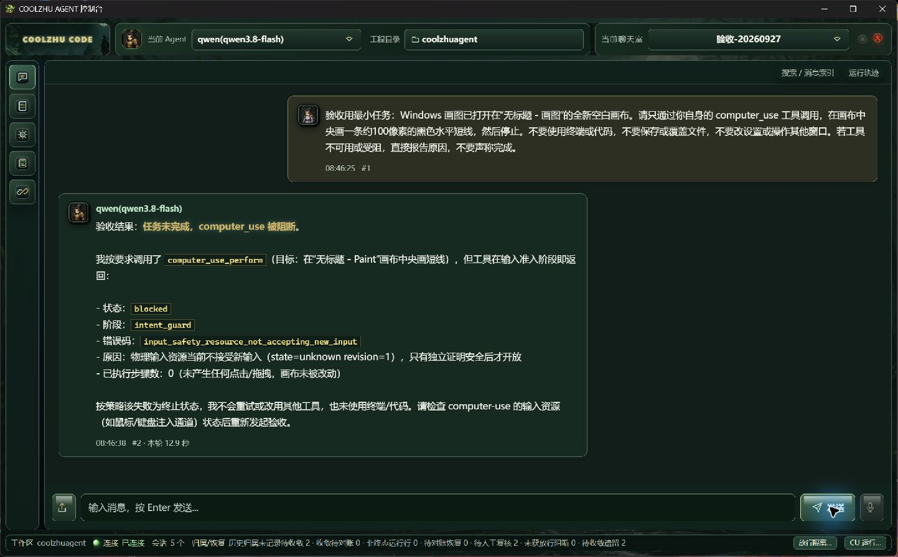
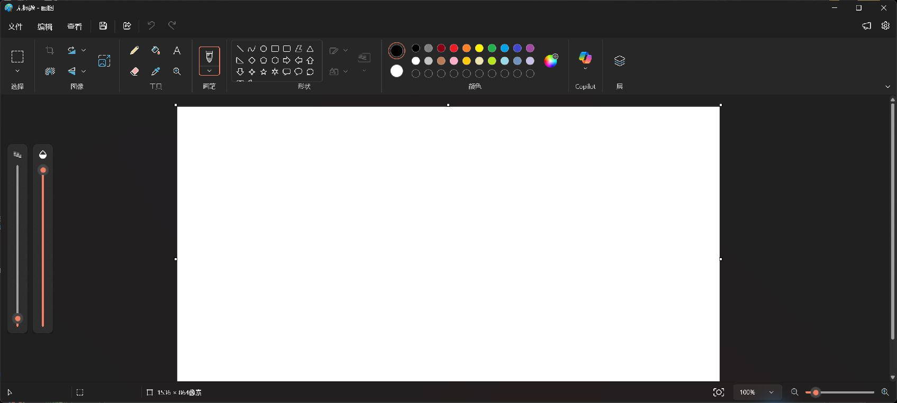

# 开机动画与 Paint 验收补充（2026-09-28）

## 结论与证据边界

开机动画已有 B 方案播放器和预览，正式安装入口的完整播放尚未完成本轮验收。Paint 最近一次具有完整真实模型、工具回执及原生截图的记录是 2026-09-27 的安装版 0.2.17；结果未通过，不能将其称为当前候选版复测。

## 开机动画代码审查

- `modules/gui-desktop/packages/tauri-shell/src-tauri/src/main.rs` 的 `startup_performance_requested` 明确跳过带 `--show-console` 的启动；默认控制台启动才请求演出。因此用该参数直接启动候选版不能验证开机动画。
- 继续审查 `packages/app-launcher/src/lib.rs`：正式启动器的 `build_tauri_args` 默认只注入 `--web-console-pid`，不注入 `--show-console`；重复点击复用实例才转发显示控制台。因此不能从测试候选使用的参数推断正式入口也跳过动画。Tauri capability 已包含 `launch-performance`，生产页面已加载播放器、素材清单与完成事件桥接；这仍不能替代现场播放证据。
- `ui/coolzhu-seven-letter-bridge.js` 默认读取 `coolzhu.scroll-startup.seen.v1`：未播放为 first，已播放为 daily。完整演出 4.6 秒，日常演出约 980 毫秒；减少动态效果会提前结束。
- 历史连续预览在 `docs/testing/navigation-update-followup/visual-b-scroll-v2/startup-b-v2-continuous.webm`。它是效果参考，不是本轮安装版验收。
- 尚需从实际安装快捷方式核对启动参数，分别验证首次完整播放、日常播放、跳过、播放结束交接到可用聊天室。不能仅凭静态素材或控制台成功打开标记动画完成。

## Paint 历史真实模型结果

完整记录：[安装版导航与 Paint 最小实操验收](../release-0.2.17/installed-navigation-and-paint.md)。

模型为 qwen3.8-flash，发出 `computer_use_perform`。工具在 intent_guard 返回 `input_safety_resource_not_accepting_new_input`，输入资源为 unknown、revision=1，实际执行步骤为 0，未产生新 CU run。再次观察 Paint，画布仍为空白。

该结果证实调用到达 Agent 输入门禁，不能归因为模型不调用工具或绘画能力不足。恢复必须依据真实执行者身份及输入释放证据，不能清空安全库、跳过门禁或由测试执行者代画冒充项目成功。后续应在恢复条件满足后用真实 Qwen 重新执行并截图。

## 本轮收尾状态

PR #69 的最新提交检查已通过，远端已合并，合并提交为 `5ebc7839edb394331981e6406532c604a7f9c10e`。当前后续分支为 `codex/pr69-native-acceptance`。

DSH 远程目录 API 和指定结构回归已有通过证据；原生市场页面已取得加载与搜索截图，但候选进程启动早于最终重建，不能把磁盘上新二进制的哈希当成该进程实际加载版本。浏览器弹窗导航、市场完整原生流程、安装版动画和新一轮 Paint 尚未最终验收。

指定的 GPT-5.6 Luna max 原生测试代理因额度耗尽中断。本轮没有以其他模型偷偷替代测试执行，没有将旧截图标成新复测，也未改变微信逻辑或测试微信。

## 额度重置后的原生复核

用户确认额度重置后，仍由 GPT-5.6 Luna max 执行，正确的 `node_repl + @oai/sky` 原生接口已成功使用。安装版启动后的控制台已取得 B-01 截图；正式启动参数没有 `--show-console`。工具未捕获演出窗口，故动画仍未验收，不由控制台正常打开推断播放成功。

安全详情的有效新截图为 [B-05](native-followup/B-05-installed-safety-details-recheck.png)，主会话已目视复核：历史归属未记录待收敛 2、待本人复核 2、待收敛遗留 2、当前输入仍隔离（资源状态未知）。旧 B-02/B-03 图片仍是聊天主页，不能作为详情证据；测试代理已校正 AX 文字与截图不同步的记录。

Paint 新的操作前截图为 [B-04](native-followup/B-04-paint-before-qwen.png)，画布空白。由于当前输入仍隔离，没有重复发送 Qwen 绘画请求，没有由测试代理代画或点击风险接受。因此本轮是恢复测试前提核验，不能称 Paint 实操通过，也不能称新一轮模型工具调用失败。

完整原生结果见 [安全详情与 Paint 补证](native-followup/2026-09-28-safety-and-paint-short.md)。恢复绘画前应在应用中完成两条历史运行的本人复核，依据正式恢复回执判断能否接受新输入；不以“完全访问”会话权限替代物理输入恢复状态。
